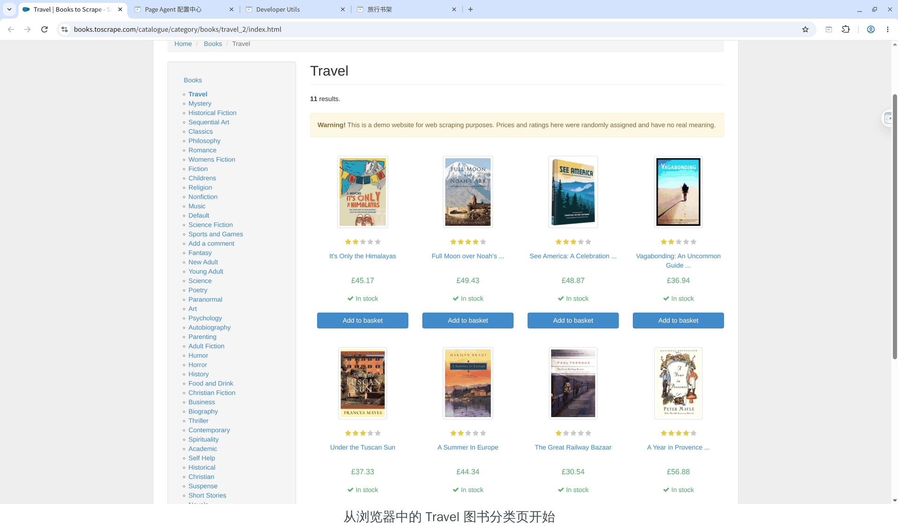

# Page Agent

**从对话到可复用的产出。**

用自然语言操作网页，把重复任务保存为流程，把常用需求做成自己的工具应用。

版本 `1.2.3` · Chrome／Edge 等 Chromium `116+` 浏览器 · [Apache 2.0](LICENSE)

[安装与上手](#安装与上手) · [已实现功能](#已实现功能) · [内置应用](#内置应用) · [MCP Server](#可选-mcp-server) · [打包](#打包) · [文档导航](#文档导航)

## 演示

从 [Books to Scrape](https://books.toscrape.com/) 采集 11 本书的书名、价格和库存，保存为可重复运行的 Flow，再通过对话生成支持搜索、排序和收藏的「旅行书架」应用。演示还包含浏览器侧栏、应用管理和内置 Developer Utils 工具。



## 已实现功能

- ✅ **网页自动化**：对话读取、点击、填表、提取数据，支持截图、操作录制和结果检查。
- ✅ **流程复用**：Flow、流程组和脚本，支持条件、循环、数据处理及模型／助手节点。
- ✅ **生成应用**：对话创建和修改，预览后发布；支持独立数据存储、流程调用、导入导出。
- ✅ **自动运行**：定时执行流程、流程组或对话；流程和流程组也可按 URL 触发。
- ✅ **运行报告**：查看节点结果与错误日志，导出 HTML／JSON 报告和失败 CSV。
- ✅ **模型与助手**：兼容 OpenAI Chat／Responses、Anthropic Messages，提供八类助手模板及知识库、Skill。
- ✅ **工具联动**：离线计算可供对话、应用、流程和脚本共用，还可接入外部 HTTP MCP 工具。
- ✅ **本地与桌面**：连接 MCP Server 后读写文件、执行 Bash、操作鼠标键盘、截图和定位图片。
- ✅ **邮件通知**：流程结束提醒、邮件节点发送，支持模板和附件，需连接 MCP Server。
- ✅ **日常管理**：应用收藏与排序、配置备份；HTTP／HTTPS／SOCKS 代理及域名匹配、绕过规则。

## 内置应用

| 应用 | 用途 |
| --- | --- |
| [开发者工具箱](builtin-apps/developer-tools/README.md) | 编解码、加密校验、JSON、正则、Cron、二维码、Docker → Compose；可复制为流程节点 |
| [Developer Utils](builtin-apps/developer-utils/README.md) | 47 项离线工具，包括格式转换、JWT 调试、证书解码、cURL 转代码和 Markdown／HTML 预览 |
| [GitLab 批量操作](builtin-apps/gitlab-tools/README.md) | 多分支 Cherry-pick、批量创建 MR；支持浏览器登录态或访问令牌，逐分支显示结果 |

在配置中心「应用」中打开。两个离线工具无需配置模型；GitLab 工具需连接自己的站点。需要定制时选「复制后修改」，再用「对话调整」修改。

## 安装与上手

使用扩展无需安装 Node.js，对话功能需配置模型服务。

1. 从 [GitHub Releases](https://github.com/openpageagent/pageagent/releases) 下载 `page-agent-extension-<version>.zip` 并解压。
2. 打开 `chrome://extensions` 或 `edge://extensions`，启用开发者模式。
3. 点击“加载已解压的扩展程序”，选择含 `manifest.json` 的 `page-agent-extension/` 目录。
4. 点击扩展图标，在「配置中心 → 模型服务」填写地址、模型、API Key 和协议。
5. 打开目标网页，从扩展菜单进入侧边栏运行助手，或使用网页内对话面板。

侧边栏快捷键：`Alt+Shift+,` 打开，`Alt+Shift+.` 关闭（macOS：`⌥⇧,` / `⌥⇧.`），分别使用键帽带 `<` / `>` 的逗号键和句号键，可在浏览器扩展快捷键设置中修改。

先试一句：“读取当前页面的商品信息，整理成表格。”完成后可继续：“把这个任务保存为 Flow。”

源码安装可直接加载仓库根目录。升级、迁移及截图模型配置见[安装说明](docs/Page-Agent-00-安装与打包.md)。

## 定时运行与邮件通知

定时支持间隔、每天多个时刻、指定日期和 Cron，可按工作日或节假日批量选日。使用浏览器本地时区，**浏览器需保持运行**；错过超过 5 分钟的固定时刻不补跑。

邮件在「连接配置 → 邮件通知」配置 SMTP 和发送连接，再开启 Flow 结束通知或添加邮件节点。见[邮件配置](docs/Page-Agent-12-邮件通知.md)。

## 可选 MCP Server

文件、Bash、桌面、邮件及外部 MCP 接入需要此服务；普通页面任务不需要。支持连接多台服务端，操作发生在 **MCP Server 所在机器**。macOS／Windows 支持桌面操作，部分功能需 `robotjs` 和系统授权；Linux 支持通过 scrot 截取 X11 桌面。

### 启动与配对

需要 Node.js ≥22.16.0。在解压后的 `page-agent-extension/` 目录运行：

```bash
node mcp-server/page-agent-mcp-server.cjs
```

从源码启动，在仓库根目录执行：

```bash
npm --prefix mcp-server install
node mcp-server/index.js
```

首次启动显示配对密码。在扩展「连接配置」填写 `ws://127.0.0.1:9999`，配对、启用并授权。

服务端名称默认取 hostname，可用 `--server-name "开发机"` 或环境变量 `PAGE_AGENT_SERVER_NAME` 指定。MCP 连接日志标题同时显示客户端和服务端的名称、ID。

认证、审计和服务端状态统一保存在启动工作目录下的 `./data/`，可用 `--state-dir <目录>` 指定；`--password <至少12位密码>` 重置密码并撤销已有配对。Bash 按服务端进程权限执行。

### Docker Compose 部署

部署文件统一位于 [`docker/`](docker/README.md)。开发时在工作区根目录操作，发布后在 release 解压根目录操作，命令相同。

- 首次构建：`./docker/build.sh all`。
- 日常更新：`./docker/build.sh app`。
- 验证打包产物：`./docker/build.sh app ./dist/page-agent-extension-1.2.3`。
- 配置文件：`docker/.env`；运行数据：`data/`。

准备好配置并构建镜像后启动：

```bash
docker compose --env-file ./docker/.env -f ./docker/compose.yaml \
  up -d --no-build --force-recreate
```

每个容器同时运行 MCP Server、Chromium 和插件，通过 `https://localhost:10000/` 查看浏览器。首次部署、镜像命名、日常更新及同步备份配置见 [Docker、同步和备份](docker/README.md)。

### 连接外部 MCP 客户端

使用 Streamable HTTP：`http://127.0.0.1:9998/mcp`，通过 Bearer 凭据认证。可通过 `PAGE_AGENT_HTTP_BEARER_TOKEN` 指定；未配置且没有已保存的令牌时，启动自动生成并显示，后续启动复用。

`/local` 直接访问服务端本地能力，无需插件；`GET /clients` 发现客户端，`POST /clients/{clientId}/arp` 转发插件资源及页面／浏览器操作。插件也可通过 WebSocket 调用同一服务端的其他客户端，服务端拒绝自调用。转发不开放流程等自动化任务的创建与运行。调用范围、桌面依赖及远程部署见 [MCP 服务](docs/Page-Agent-11-MCP服务.md)。

## 打包

需要 Node.js ≥22.16.0 和 npm。以下命令在仓库根目录执行，依赖未变化可跳过安装。

### 扩展发布包

另需 Bash、`rsync` 和 `zip`。

```bash
npm install
npm --prefix mcp-server install
./page-agent-build.sh
```

产物：

```text
dist/page-agent-extension-<version>/
dist/page-agent-extension-<version>.zip
```

包内包含 MCP 单文件服务端。`./page-agent-build.sh --no-minify` 保留扩展 JS／CSS 原格式，MCP 单文件仍压缩。详见[打包说明](docs/Page-Agent-02-发布包与代码压缩.md)。

### 独立打包 MCP Server

```bash
npm --prefix mcp-server ci
npm --prefix mcp-server run build:single
```

产物为 `mcp-server/dist/page-agent-mcp-server.cjs`，启动：

```bash
node mcp-server/dist/page-agent-mcp-server.cjs
```

## 文档导航

| 想了解什么 | 文档 |
| --- | --- |
| 安装、升级、迁移与打包 | [安装与打包](docs/Page-Agent-00-安装与打包.md) · [发布包与代码压缩](docs/Page-Agent-02-发布包与代码压缩.md) |
| 对话、助手与流程 | [对话入口与页面绑定](docs/Page-Agent-03-对话入口与页面绑定.md) · [内置助手](docs/Page-Agent-04-内置助手.md) · [提示词与 Flow 节点](docs/Page-Agent-06-提示词与Flow节点.md) |
| 模型、知识与 Skill | [模型服务兼容性](docs/Page-Agent-08-模型服务兼容性.md) · [知识系统](docs/Page-Agent-05-知识系统.md) · [提示词缓存](docs/Page-Agent-07-提示词缓存.md) |
| 创建、使用和分享应用 | [应用说明](docs/Page-Agent-13-应用.md) |
| 本地操作、外部接入与通知 | [MCP 服务](docs/Page-Agent-11-MCP服务.md) · [邮件通知](docs/Page-Agent-12-邮件通知.md) |
| 工具调用与资源接口 | [ARP 工具调用](docs/Page-Agent-09-ARP工具调用.md) · [ARP 协议](docs/Page-Agent-10-ARP协议.md) |
| 反馈问题与参与贡献 | [贡献与问题反馈](docs/Page-Agent-01-贡献与问题反馈.md) |

## 权限与数据

配置与应用数据保存在本机浏览器；模型请求发送到你配置的服务，内容不会自动脱敏。应用与 MCP 本地操作需按用途授权。

备份不含模型凭据和 MCP 配对凭据，导出的邮件配置含明文 SMTP 密码／授权码。见[迁移说明](docs/Page-Agent-00-安装与打包.md#升级与迁移)。

## 致谢

感谢 [Linux.do](https://linux.do/) 社区以及各位佬友的经验分享。

## 许可与协作

项目使用 Apache 2.0，第三方许可见 [THIRD_PARTY_NOTICES.md](THIRD_PARTY_NOTICES.md)，使用前请阅读[免责声明](DISCLAIMER.md)。

个人项目，业余维护；代码与文档由 AI 工具生成和维护，不提供商业服务或即时响应承诺。唯一公开联系方式：`harrylee@linux.do`。

反馈与贡献请阅读 [CONTRIBUTING.md](CONTRIBUTING.md)，提交使用 [PR 模板](.github/pull_request_template.md)；安全问题按 [SECURITY.md](SECURITY.md) 报告。
